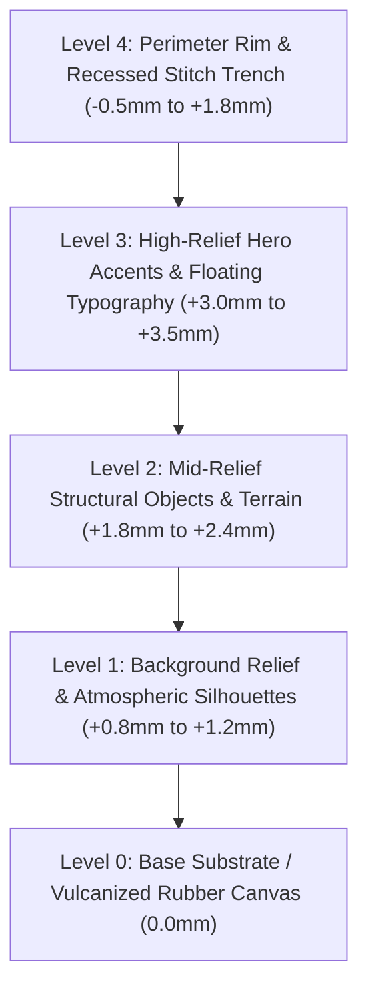

# 🪡 Trailmate Tactile 3D Molded PVC Rubber Morale Patch Design System
**Version:** 1.0.0 • **Status:** Production Specification • **Target:** Web UI, SVG Canvas, Scrapbook Studio & Stitch MCP

---

## 1. Executive Summary & Aesthetic Vision

The **Trailmate Tactile PVC & Rubber Morale Patch Design System** translates the physical, dimensional, and tactile qualities of vulcanized molded PVC/silicone outdoor morale patches and expedition badges into digital interfaces and interactive scrapbook elements.

### The Origin: Physical Morale Patches & Expedition Badges
Physical PVC morale patches are standard equipment across overland 4x4 rigs, mountaineering packs, tactical field gear, and expedition apparel. Unlike flat embroidered badges with frayed threads, molded PVC patches feature:
- **Die-Cast Sharpness:** Micro-injected liquid polyvinyl chloride cured in precision CNC metal molds.
- **True Multi-Tier Relief:** Distinct vertical tiers ranging from recessed baseline canvas up to proud +3.5mm high-relief vehicle roll-cages, mountain crests, and glowing campfire flames.
- **Matte Micro-Stippling:** Non-glossy silicone surfaces textured with pebble stippling to eliminate sun glare while maximizing grip and tactile depth.
- **The Perimeter Stitch Groove:** A deeply recessed containment channel 2–3mm from the die-cut edge with heavy nylon thread running through recessed needle punctures.

```
┌────────────────────────────────────────────────────────────────────────┐
│                        PHYSICAL CROSS-SECTION                          │
│                                                                        │
│       Level 3: Bold 3D Letters / Vehicle Body / Flame (+3.2mm)         │
│                 ┌────────┐             ┌────────┐                      │
│                 │  TEXT  │             │ 4x4 RIG│                      │
│       Level 2:  │ ┌──────┴─────────────┴──────┐ │ (+2.0mm Mountain)    │
│  Level 4: Rim   │ │     SEDONA SANDSTONE      │ │      Level 4: Rim    │
│  ┌─┐  Stitch   ┌┴─┴───────────────────────────┴─┴┐    Stitch  ┌─┐      │
│  │ │  Trench   │     Level 1: PINES / SKYLINE    │    Trench  │ │      │
│  │ │   [ • ]   │             (+1.0mm)            │    [ • ]   │ │      │
│  │ └───[───]───┴─────────────────────────────────┴────[───]───┘ │      │
│  └──────────────────────────────────────────────────────────────┘      │
│                 Level 0: Substrate Base Rubber (0.0mm)                 │
└────────────────────────────────────────────────────────────────────────┘
```

### Synthesis of the Three Archetypes
This design system synthesizes three physical patch references into a cohesive digital system:
1. **The Tactical Night-Ops Archetype (Reference 1):**
   * *Base & Mood:* Stealth Matte Graphite `#161719` rubber canvas, deep debossed needle trench.
   * *Relief Elements:* Heavy embossed industrial block lettering (`ADVENTURE OFFROAD`), fluid cursive script (`Extreme`), dark relief evergreen forest backdrop.
   * *High-Relief Hero:* High-visibility Neon Lime `#39FF14` 4x4 expedition rig with molded roll-cage and spare tire.
2. **The High-Desert Overland Archetype (Reference 2):**
   * *Base & Mood:* Multi-color molded relief, micro-stippled desert sandstone terrain `#E09F3E`, radiant sunset speed-lines.
   * *Relief Elements:* Bold cream `#F1E9DA` 3D molded lettering (`OFF ROAD`), Bedrock Crimson `#9E2A2B` chassis crawling up steep red-rock slickrock ridges.
   * *Finish:* High-density pebbled silicone stippling on the ground plane, smooth satin gloss on vehicle body panels.
3. **The Nocturnal Alpine Expedition Archetype (Reference 3):**
   * *Base & Mood:* Custom die-cut crescent moon silhouette, deep Twilight Navy `#0F172A` substrate, perimeter stitch channel.
   * *Relief Elements:* Layered alpine mountain peaks, deep forest pines, expedition dome tent in Hazard Orange `#FF671F`.
   * *Luminous Accents:* Golden Campfire Flame `#FBBF24` with molded stone ring, volumetric billowing smoke plume, and diamond starlight pinpoints.

---

## 2. Depth & Layer Stack (5-Tier Physical Relief Model)

To produce authentic tactile dimensionality in CSS and SVG, all visual elements are organized into a strict 5-tier Z-axis stack.



### Detailed Elevation Matrix

| Level | Physical Height | Digital Elevation / CSS Representation | Optical Characteristics | Example Components |
|---|---|---|---|---|
| **Level 0: Substrate Base** | `0.0mm` | Foundation plane; subtle dark noise texture; soft inner boundary shadow. | Semi-matte vulcanized rubber; absorbs light; provides base contrast. | Patch backplate, card canvas, modal container body. |
| **Level 1: Low Relief** | `+0.8mm - +1.2mm` | `box-shadow: 0 1px 2px rgba(0,0,0,0.5)`, bevel highlight `0.5px`. | Shallow cast shadows; flat tops; softened draft-angle edges. | Silhouetted pine tree groves, distant mountain horizons, sunset speed-bands, debossed grid coordinates. |
| **Level 2: Mid Relief** | `+1.8mm - +2.4mm` | `box-shadow: 0 2px 4px rgba(0,0,0,0.65), 0 1px 1px rgba(0,0,0,0.4)`. | Pronounced cast shadow on lower-right; crisp specular rim highlight on upper-left. | Sandstone rock ledges, expedition tents, vehicle chassis, campfire stone rings, badge inner shields. |
| **Level 3: High Relief** | `+3.0mm - +3.5mm` | `box-shadow: 0 4px 8px rgba(0,0,0,0.8), 0 1px 2px rgba(0,0,0,0.5)`. | Deep ambient occlusion; dual-stage cast shadow; pillowy rounded relief crowns. | High-visibility Neon Lime rig, campfire flame tips, extruded 3D block lettering, cursive noodle scripts, star diamonds. |
| **Level 4: Rim & Trench** | Base: `+1.8mm`, Trench: `-0.5mm` | Outer raised border + `inset 0 1px 2px rgba(0,0,0,0.8)` trench + dashed stitch thread. | Raised exterior bevel; dark recessed trench groove; threaded nylon stitch bars with needle punch holes. | Perimeter patch border, badge frames, button margins, interactive card containment borders. |

### Edge Draft Angle Physics
In physical rubber injection molds, vertical walls cannot be perpendicular ($90^\circ$); they require a **$3^\circ$ to $5^\circ$ mold release draft angle**. In digital rendering:
- Relief edges are **never razor-sharp vertical cliffs**.
- Edges feature a **$0.75\text{px}$ to $1.5\text{px}$ chamfer/bevel** that captures directional light highlights on the top-left and casts immediate contact occlusions on the bottom-right.
- Convex relief crowns have a soft radius ($R = 0.5\text{px}$ to $1.5\text{px}$), giving letters and icons the signature "puffy molded rubber" feel.

---

## 3. Micro-Texture Physics & Lighting Model

### 3.1 Mold Stippling & Pebble Grain
Physical patches feature fine surface stippling on flat substrate zones to break surface tension and prevent specular glare.
- **Grain Density:** High-frequency, sub-pixel micro-noise (perlin or simplex noise, octaves 3–4, frequency 0.65).
- **Relief Polishing:** Raised lettering and vehicle bodywork (Level 2 & 3) have a **smooth satin micro-finish**, contrasting against the **coarse stippled rubber base** (Level 0).

### 3.2 Lighting Direction & Specular Geometry
All lighting across components and patches follows a single, consistent global directional vector:
- **Light Azimuth:** $315^\circ$ (Top-Left corner light source).
- **Light Elevation:** $45^\circ$ from the horizontal plane.
- **Ambient Fill:** Warm environmental bounce light at $15\%$ intensity to prevent crushed pitch-black shadows.
- **Specular Quality:** Low shine ($K_s = 0.25$, Specular Exponent $\approx 22$). This models silicone/fluororubber rather than shiny hard polycarbonate or acrylic.

```
                  ☀️ Sun / Key Light
                 \ (315° Azimuth, 45° Alt)
                  \
                   v
       [ Top-Left Edge: 0.75px Specular Cream Highlight #FFFFFF, 25% ]
       ┌─────────────────────────────────────────────────────────────┐
       │                                                             │
       │                   MOLDED RUBBER ELEMENT                     │
       │                                                             │
       └─────────────────────────────────────────────────────────────┘
       [ Bottom-Right Edge: 1.5px Ambient Occlusion #000000, 60% ]
           \
            v [ Cast Drop-Shadow: 3px - 6px Gaussian Blur #000000, 75% ]
```

### 3.3 Perimeter Stitching Trench Specifications
The perimeter stitching trench is the hallmark of genuine outdoor morale patches:
1. **Outer Raised Lip:** $1.5\text{mm}$ wide raised rim at Level 2 height (`+1.8mm`).
2. **The Recessed Groove (Trench):** A $1.2\text{mm}$ wide channel routed $-0.5\text{mm}$ into the rubber substrate. Rendered via dark inset shadows (`inset 0 1px 2px rgba(0,0,0,0.9)`).
3. **The Stitch Dashes:** Heavy gauge nylon/polyester cord running down the center of the trench:
   - Dash length: $5\text{px} - 7\text{px}$.
   - Gap between stitches: $3\text{px} - 4\text{px}$.
   - Thread relief: Sits proud of the trench floor (+0.3mm), rendered with a tiny drop shadow and a micro thread twist gradient.
   - Puncture Depressions: Dark circular pits at the start and end of each thread dash where the needle plunged through the rubber.

---

## 4. Color Harmonies & Rubber Pigments

Molded PVC patches use pre-mixed, through-dyed liquid vinyl pigments. These colors do not blend like inks; each zone is a solid, opaque vulcanized reservoir separated by thin relief mold dams.

```
       TACTICAL CHARCOAL          DEEP INDIGO SUBSTRATE         HAZARD ORANGE
         #161719                       #0F172A                    #FF671F
       ██████████████              ██████████████             ██████████████

          NEON LIME                  SEDONA SANDSTONE            ALPINE TURQUOISE
         #39FF14                       #E09F3E                    #38BDF8
       ██████████████              ██████████████             ██████████████

       BEDROCK CRIMSON                CAMPFIRE GOLD              BONE CREAM
         #9E2A2B                       #FBBF24                    #F1E9DA
       ██████████████              ██████████████             ██████████████
```

### Palette Token Reference

| Token Name | Hex Code | RGB | Material Definition & Role | Visual Weight |
|---|---|---|---|---|
| `pvc-substrate-charcoal` | `#161719` | `22, 23, 25` | Tactical stealth graphite rubber base; heavy carbon pigment. | Foundation Base |
| `pvc-substrate-indigo` | `#0F172A` | `15, 23, 42` | Twilight alpine night sky substrate; nocturnal foundation. | Foundation Base |
| `pvc-accent-neon-lime` | `#39FF14` | `57, 255, 20` | High-visibility rescue pigment; offroad Jeep roll-cage & trail highlight. | Primary High-Relief |
| `pvc-accent-hazard-orange`| `#FF671F`| `255, 103, 31`| Expedition tent nylon, safety winch hooks, urgent trail warnings. | High-Relief Accent |
| `pvc-terrain-sandstone` | `#E09F3E` | `224, 159, 62`| Sedona red-rock stratum, topographic ridges, contour bands. | Mid-Relief Terrain |
| `pvc-terrain-bedrock` | `#9E2A2B` | `158, 42, 43` | Iron-rich clay, rock-crawling boulder surfaces, rig body panels. | Mid-Relief Accent |
| `pvc-sky-turquoise` | `#38BDF8` | `56, 189, 248`| Alpine glacial tarns, crisp atmospheric skyline, overland body cyan. | Mid/High Relief |
| `pvc-flame-gold` | `#FBBF24` | `251, 191, 36`| Campfire heart, star diamonds, high-priority milestone badges. | High-Relief Accent |
| `pvc-lettering-cream` | `#F1E9DA` | `241, 233, 218`| Vulcanized warm bone-white lettering; soft matte vintage contrast. | Typography Relief |
| `pvc-forest-evergreen` | `#143621` | `20, 54, 33` | Dense sub-alpine pine forest canopy; low-relief background silhouette.| Background Relief |
| `pvc-stitch-khaki` | `#A3A380` | `163, 163, 128`| Heavy-gauge bonded polyester thread; military desert drab. | Stitch Detail |
| `pvc-stitch-silver` | `#CBD5E1` | `203, 213, 225`| High-visibility reflective nylon perimeter thread. | Stitch Detail |

### Harmonic Pairings

```
1. TACTICAL OVERLAND
   [#161719 Charcoal Base] + [#39FF14 Neon Lime Accent] + [#F1E9DA Bone Cream Text]
   Ideal for: Offroad trails, rugged 4x4 routes, technical telemetry chips.

2. SEDONA RED-ROCK
   [#161719 Charcoal Base] + [#E09F3E Sandstone Gold] + [#9E2A2B Bedrock Crimson] + [#38BDF8 Cyan Body]
   Ideal for: Desert hikes, canyon expeditions, warmth and rock-crawling milestones.

3. ALPINE NOCTURNE
   [#0F172A Twilight Navy Base] + [#143621 Evergreen Pines] + [#FF671F Hazard Tent] + [#FBBF24 Campfire Flame]
   Ideal for: Overnight camp itineraries, stargazing spots, wilderness achievements.
```

---

## 5. Typography Rules: Molded Grotesque, Noodle Script & Technical Arch

Typography on molded rubber patches must abide by the physical constraints of CNC tool paths and silicone casting:

```
┌────────────────────────────────────────────────────────────────────────┐
│                        TYPOGRAPHIC ANATOMY                             │
│                                                                        │
│   1. MOLDED INDUSTRIAL GROTESQUE:                                      │
│      A D V E N T U R E   O F F R O A D                                 │
│      ▲ Heavy block caps, +0.12em tracking, chamfered relief borders     │
│                                                                        │
│   2. EXTRUDED RUBBER NOODLE SCRIPT:                                    │
│      Extreme  /  Wanderlust                                            │
│      ▲ Monoline fluid tube, rounded stroke caps, proud +3.5mm height   │
│                                                                        │
│   3. TECHNICAL PERIMETER ARCH:                                         │
│        ╭────────── TRAILMATE EXPEDITION ──────────╮                     │
│      ( Arch path tracking, condensed sans, debossed in rim trench )    │
└────────────────────────────────────────────────────────────────────────┘
```

### 5.1 Style 1: Molded Industrial Grotesque (Primary Headline / Shield Title)
- **Primary Typefaces:** `Bebas Neue`, `Anton`, `Oswald`, `Barlow Condensed`, `Bricolage Grotesque`.
- **Case:** Strict Uppercase (`text-transform: uppercase`).
- **Weight:** Ultra-Bold or Black (`font-weight: 800` to `900`).
- **Letter Spacing:** Wide tracking (`letter-spacing: 0.12em` to `0.22em`) to guarantee mold release channels between glyphs.
- **Dimensional Relief:** Level 3 (+3.0mm). Features a crisp top-left highlight and deep bottom shadow. Rounded corner radius on glyph stems ($0.5\text{px}$ fillet) to replicate molten rubber curing.

### 5.2 Style 2: Fluid Rubber Noodle Script (Badge Flair & Milestone Accents)
- **Primary Typefaces:** Fluid monoline scripts or rounded display faces (`Comfortaa` at ultra-bold, customized SVG noodle strokes, or retro brush scripts like `Yellowtail` / `Pacifico` with heavy stroke fattening).
- **Physical Feel:** Resembles an extruded bead of liquid silicone or cake frosting squeezed through a round nozzle.
- **Geometry:**
  - Constant stroke width across ascenders, loops, and descenders.
  - Full round stroke caps (`stroke-linecap: round`, `stroke-linejoin: round`).
  - No hairline serifs or tapered terminals (which would break or fail to demold).
- **Dimensional Relief:** Sits proudly at Level 3.5 (+3.5mm), often overlapping Level 2 terrain or Level 1 pine groves.

### 5.3 Style 3: Arched Perimeter Technical Lettering
- **Usage:** Secondary coordinates, elevation badges, organization names along the outer circular or crescent rim (e.g., `* ELEV. 14,265 FT * EST. 2026 *`).
- **Implementation:** SVG `<textPath>` aligned to an interior concentric circular arc.
- **Typeface:** Clean, condensed geometric sans-serif (`Space Grotesk`, `Inter`, `Public Sans`).
- **Relief:** Subtle low-relief (+1.0mm) or stamped debossed relief (-0.5mm) recessed directly into the outer rim collar.

---

## 6. Web Implementation: SVG Filters & CSS Recipes

### 6.1 Reusable SVG Filter Pipeline
Below is the production-ready SVG filter suite designed specifically for rendering authentic rubber relief, micro-stippling, and perimeter stitching trenches.

```html
<svg width="0" height="0" class="absolute pointer-events-none" aria-hidden="true">
  <defs>
    <!-- 1. HIGH-RELIEF RUBBER MOLD FILTER (Top-Left Highlight + Directional Drop-Shadow) -->
    <filter id="pvc-relief-high" x="-20%" y="-20%" width="150%" height="150%">
      <!-- Extract alpha for height mapping -->
      <feGaussianBlur in="SourceAlpha" stdDeviation="1.2" result="blurAlpha" />
      
      <!-- Directional Specular Light (Top-Left Highlight) -->
      <feSpecularLighting in="blurAlpha" surfaceScale="3" specularConstant="0.45" 
                          specularExponent="20" lighting-color="#ffffff" result="specularLight">
        <feDistantLight azimuth="315" elevation="48" />
      </feSpecularLighting>
      
      <!-- Mask specular highlight to element silhouette -->
      <feComposite in="specularLight" in2="SourceAlpha" operator="in" result="specularHighlight" />
      
      <!-- Directional Cast Shadow (Bottom-Right) -->
      <feDropShadow dx="2" dy="3.5" stdDeviation="2.5" flood-color="#000000" flood-opacity="0.75" result="dropShadow" />
      
      <!-- Ambient Occlusion Shadow -->
      <feDropShadow dx="0.5" dy="1" stdDeviation="1" flood-color="#000000" flood-opacity="0.5" result="aoShadow" />
      
      <!-- Blend Original Graphics over Shadows, then Add Specular Highlight -->
      <feMerge>
        <feMergeNode in="dropShadow" />
        <feMergeNode in="aoShadow" />
        <feMergeNode in="SourceGraphic" />
        <feMergeNode in="specularHighlight" />
      </feMerge>
    </filter>

    <!-- 2. MICRO-STIPPLE RUBBER TEXTURE GENERATOR -->
    <filter id="pvc-stipple-texture" x="0%" y="0%" width="100%" height="100%">
      <!-- High frequency grain for rubber pebble effect -->
      <feTurbulence type="fractalNoise" baseFrequency="0.8" numOctaves="3" result="noise" />
      <feColorMatrix type="matrix" values="0 0 0 0 0
                                           0 0 0 0 0
                                           0 0 0 0 0
                                           0 0 0 0.18 0" result="fadedNoise" />
      <feComposite in="SourceGraphic" in2="fadedNoise" operator="over" />
    </filter>

    <!-- 3. DEBOSSED STITCH TRENCH FILTER -->
    <filter id="pvc-trench-deboss" x="-10%" y="-10%" width="120%" height="120%">
      <feOffset dx="0" dy="1.5" in="SourceAlpha" result="offset" />
      <feGaussianBlur stdDeviation="1" in="offset" result="blur" />
      <feComposite operator="out" in="SourceAlpha" in2="blur" result="inverseShadow" />
      <feFlood flood-color="#000000" flood-opacity="0.85" result="shadowColor" />
      <feComposite operator="in" in2="inverseShadow" result="innerShadow" />
      
      <feMerge>
        <feMergeNode in="SourceGraphic" />
        <feMergeNode in="innerShadow" />
      </feMerge>
    </filter>
  </defs>
</svg>
```

### 6.2 Pure CSS Tactile Rubber Recipe (Buttons & Badges)
This pure CSS implementation applies layered `box-shadow` values to simulate mold bevels, 45-degree top-left sunlight, and rubber elasticity under user interaction.

```css
/* Base Rubber Substrate Card / Container */
.pvc-patch-base {
  background-color: #161719;
  border-radius: 9999px; /* Or custom die-cut border */
  position: relative;
  /* Multi-stage contact shadow & base thickness */
  box-shadow: 
    0 10px 25px -5px rgba(0, 0, 0, 0.8),
    0 8px 10px -6px rgba(0, 0, 0, 0.6),
    /* Edge bevel highlights and bottom rim shadow */
    inset 0 1.5px 1px rgba(255, 255, 255, 0.18),
    inset 0 -2px 3px rgba(0, 0, 0, 0.8);
  border: 2px solid #232528;
}

/* Recessed Stitch Trench Groove */
.pvc-stitch-trench {
  position: absolute;
  inset: 5px;
  border-radius: inherit;
  pointer-events: none;
  /* Inset groove shadow */
  box-shadow: 
    inset 0 1px 2px rgba(0, 0, 0, 0.9),
    inset 0 -0.5px 1px rgba(255, 255, 255, 0.08);
  /* The Stitched Thread Dashes */
  border: 1.5px dashed #A3A380;
  opacity: 0.85;
}

/* Molded Rubber Action Button (Level 3 Relief) */
.pvc-rubber-btn {
  display: inline-flex;
  align-items: center;
  justify-content: center;
  font-family: 'Bebas Neue', 'Oswald', sans-serif;
  letter-spacing: 0.14em;
  text-transform: uppercase;
  font-size: 1.15rem;
  padding: 12px 28px;
  border-radius: 12px;
  background: linear-gradient(180deg, #42FF1E 0%, #30DE0D 100%);
  color: #0E2405;
  font-weight: 900;
  text-shadow: 0 1px 0 rgba(255, 255, 255, 0.35);
  border: none;
  cursor: pointer;
  position: relative;
  user-select: none;
  
  /* Physical rubber molded elevation */
  box-shadow:
    /* Top-left specular bevel highlight */
    inset 0 2px 1px rgba(255, 255, 255, 0.45),
    /* Bottom rubber edge draft chamfer */
    inset 0 -2px 2px rgba(0, 0, 0, 0.3),
    /* Mold base rim boundary */
    0 0 0 1px #229A09,
    /* Level 3 Ground Drop Shadow */
    0 4px 6px -1px rgba(0, 0, 0, 0.7),
    0 2px 4px -2px rgba(0, 0, 0, 0.5);
  
  transition: transform 0.12s cubic-bezier(0.34, 1.56, 0.64, 1), 
              box-shadow 0.12s ease-out;
}

/* Hover: Slight elastic spring expansion */
.pvc-rubber-btn:hover {
  transform: translateY(-1.5px);
  box-shadow:
    inset 0 2px 1px rgba(255, 255, 255, 0.55),
    inset 0 -2px 2px rgba(0, 0, 0, 0.3),
    0 0 0 1px #229A09,
    0 7px 12px -2px rgba(0, 0, 0, 0.75),
    0 4px 6px -2px rgba(0, 0, 0, 0.6);
}

/* Active / Press: Mechanical rubber compression (Spring squish) */
.pvc-rubber-btn:active {
  transform: translateY(2px);
  box-shadow:
    inset 0 1px 1px rgba(0, 0, 0, 0.4),
    inset 0 -1px 1px rgba(255, 255, 255, 0.2),
    0 0 0 1px #1E8208,
    0 1px 2px rgba(0, 0, 0, 0.8);
}
```

### 6.3 Complete SVG Master Patch Template (Sedona Red-Rock Crawl)
This standalone SVG can be used directly as a hero emblem, scrapbook sticker, or interactive badge:

```xml
<svg viewBox="0 0 240 240" width="240" height="240" xmlns="http://www.w3.org/2000/svg">
  <!-- DEFINE SHADOWS & HIGHLIGHT FILTERS -->
  <defs>
    <!-- Directional Bevel Specular for 3D Rubber Lettering -->
    <filter id="pvc-bevel" x="-20%" y="-20%" width="140%" height="140%">
      <feDropShadow dx="1" dy="2.5" stdDeviation="1.5" flood-color="#000000" flood-opacity="0.8" />
    </filter>
    <filter id="pvc-emboss-deep" x="-20%" y="-20%" width="140%" height="140%">
      <feDropShadow dx="1.5" dy="3" stdDeviation="2" flood-color="#000000" flood-opacity="0.9" />
    </filter>
  </defs>

  <!-- LEVEL 0: BASE SUBSTRATE (Tactical Graphite Die-Cut Disc) -->
  <circle cx="120" cy="120" r="114" fill="#161719" stroke="#25272B" stroke-width="3" />
  
  <!-- LEVEL 4: RECESSED STITCHING TRENCH -->
  <circle cx="120" cy="120" r="105" fill="none" stroke="#0B0C0E" stroke-width="4.5" />
  <!-- NYLON THREAD STITCH DASHES -->
  <circle cx="120" cy="120" r="105" fill="none" stroke="#A3A380" stroke-width="1.8" 
          stroke-dasharray="6.5 4" stroke-linecap="round" />

  <!-- LEVEL 1: BACKGROUND RELIEF (Sunset Speed-Lines & Evergreen Silhouette) -->
  <g id="level-1-sky" opacity="0.95">
    <!-- Sunset horizontal rubber bands -->
    <path d="M 30,110 A 95,95 0 0,1 210,110 Z" fill="#9E2A2B" opacity="0.35" />
    <path d="M 40,95 A 95,95 0 0,1 200,95 Z" fill="#E09F3E" opacity="0.45" />
    <path d="M 55,80 A 95,95 0 0,1 185,80 Z" fill="#FBBF24" opacity="0.3" />
  </g>

  <!-- Pine Forest Silhouette (Debossed relief) -->
  <g fill="#143621" opacity="0.85">
    <polygon points="50,135 60,110 70,135" />
    <polygon points="62,138 72,115 82,138" />
    <polygon points="160,138 170,115 180,138" />
    <polygon points="172,135 182,112 192,135" />
  </g>

  <!-- LEVEL 2: MID-RELIEF OBJECTS (Sedona Sandstone Ridges) -->
  <path d="M 22,145 Q 70,120 120,135 T 218,140 L 218,175 Q 120,205 22,175 Z" 
        fill="#E09F3E" filter="url(#pvc-bevel)" />
  <path d="M 24,158 Q 75,138 120,150 T 216,152 L 216,182 Q 120,210 24,182 Z" 
        fill="#9E2A2B" filter="url(#pvc-bevel)" />

  <!-- LEVEL 3: HIGH-RELIEF HERO (Neon Lime Overland 4x4 Rig) -->
  <g id="overland-rig" filter="url(#pvc-emboss-deep)">
    <!-- Wheels / Heavy Mud Tires -->
    <rect x="75" y="130" width="22" height="34" rx="6" fill="#0C0D0E" stroke="#161719" stroke-width="1.5" />
    <rect x="145" y="130" width="22" height="34" rx="6" fill="#0C0D0E" stroke="#161719" stroke-width="1.5" />
    <circle cx="86" cy="147" r="4.5" fill="#39FF14" />
    <circle cx="156" cy="147" r="4.5" fill="#39FF14" />

    <!-- 4x4 Body Chassis (Cyan + Neon Lime Accents) -->
    <path d="M 72,132 L 85,110 L 155,110 L 170,132 L 170,140 L 72,140 Z" fill="#38BDF8" />
    <!-- Roll-Cage / Roof Rack Tube in Neon Lime -->
    <path d="M 88,110 L 98,92 L 144,92 L 152,110 Z" fill="none" stroke="#39FF14" stroke-width="4.5" 
          stroke-linecap="round" stroke-linejoin="round" />
    <!-- Windshield & Cab Window (Molded Dark Indigo) -->
    <polygon points="101,95 141,95 148,108 94,108" fill="#0F172A" />
    <!-- Overland Snorkel & Roof Spotlights -->
    <circle cx="108" cy="88" r="3" fill="#FBBF24" />
    <circle cx="120" cy="88" r="3" fill="#FBBF24" />
    <circle cx="132" cy="88" r="3" fill="#FBBF24" />
  </g>

  <!-- LEVEL 3: HIGH-RELIEF 3D BLOCK TYPOGRAPHY -->
  <!-- Arc Top Banner: "ADVENTURE OFFROAD" -->
  <path id="arch-top" d="M 38,110 A 88,88 0 0,1 202,110" fill="none" />
  <text font-family="'Bebas Neue', 'Oswald', sans-serif" font-weight="900" font-size="20" 
        fill="#F1E9DA" letter-spacing="2.5" filter="url(#pvc-bevel)">
    <textPath href="#arch-top" startOffset="50%" text-anchor="middle">
      ADVENTURE OFFROAD
    </textPath>
  </text>

  <!-- Fluid Noodle Script: "Extreme" (Proud Liquid Rubber Extrusion) -->
  <text x="120" y="74" text-anchor="middle" font-family="'Brush Script MT', cursive, sans-serif" 
        font-size="26" font-style="italic" fill="#39FF14" filter="url(#pvc-emboss-deep)"
        stroke="#161719" stroke-width="1.2" paint-order="stroke fill">
    Extreme
  </text>

  <!-- Bottom Arch Subtitle: "SEDONA SLICKROCK • 4,500 FT" -->
  <path id="arch-bottom" d="M 45,155 A 88,88 0 0,0 195,155" fill="none" />
  <text font-family="'Space Grotesk', sans-serif" font-weight="700" font-size="8.5" 
        fill="#E09F3E" letter-spacing="1.8">
    <textPath href="#arch-bottom" startOffset="50%" text-anchor="middle">
      ★ SEDONA SLICKROCK • 4,500 FT ★
    </textPath>
  </text>
</svg>
```

---

## 7. Component Architecture for Trailmate UI & Scrapbook Studio

### 7.1 Component 1: Expedition Milestone & Badge Patches
- **Use Cases:**
  - Completed Itinerary Milestones (`14er Summit Club`, `Red Rock Overland`, `Coast-to-Coast Express`).
  - Scrapbook Sticker Drawer (tactile draggable badges on canvas).
  - User Profile Field Badges & Verification Medals.
- **Interactions:**
  - `Drag & Drop` on Scrapbook Canvas with realistic inertial snap.
  - Hover triggers a subtle $+3^\circ$ tilt-angle parallax shift simulating holding the physical rubber patch in direct light.
  - Double-click triggers an inspect view detailing elevation, GPS coordinates, and completion date debossed on the virtual patch backplate.

### 7.2 Component 2: Tactile Rubber Category Filter Chips
- **Use Cases:** Filtering itinerary stops (`All`, `Off-Road Trails`, `Scenic Overlooks`, `Campgrounds`, `Fuel & Rigs`).
- **Visual State Architecture:**
  - **Inactive Chip:** Flat matte graphite (`#161719`), perimeter recessed trench with dark stitching, cream text at Level 1 relief (+1.0mm).
  - **Hover Chip:** Slight $+1\text{px}$ spring lift; top-left specular highlight intensifies.
  - **Active / Selected Chip:** Snaps to high-relief molded state; background fills with Neon Lime (`#39FF14`) or Sandstone Gold (`#E09F3E`); black debossed text; perimeter stitch shifts to high-contrast khaki thread.

### 7.3 Component 3: Heavy Duty CTA Buttons ("Confirm Rig", "Generate Expedition Itinerary")
- **Visual Design:** Rectangular heavy silicone block with filleted $10\text{px}$ corners, side grip ridges (ribbed tread along left and right flanks), bold molded sans-serif typography, and audible/tactile haptic feedback on touch devices.

### 7.4 Component 4: Scrapbook Studio Embellishment System
Within the Trailmate Scrapbook Studio (`/src/scrapbook`), morale patches are treated as **Level 3 Embellishments** alongside vintage stamps and washi tape:
- **Depth Hierarchy:**
  - Level 0: Scrapbook Textured Kraft/Parchment Paper Canvas.
  - Level 1: Flat Photos & Travel Journal Scraps.
  - Level 2: Washi Tape Strips & Postmarks.
  - Level 3: **Tactile PVC Morale Patches** (casts heavy directional drop-shadows onto underlying photos and tape, grounding the entire composition).

---

## 8. Stitch MCP `DESIGN.md` Specification Section

The following section is formatted in exact compliance with the **Stitch MCP `DESIGN.md`** specification standard. It is ready for direct upload via the `stitch:upload_design_md` tool and conversion into dynamic project design systems via `stitch:create_design_system_from_design_md`.

```markdown
# Design System Specification: Trailmate Tactile PVC Morale Patches

## 1. Theme Configuration
- **Name:** Trailmate Tactile PVC & Overland Morale
- **Color Mode:** DARK
- **Custom Primary Seed Color:** `#39FF14` (Neon Lime)
- **Color Variant:** VIBRANT
- **Headline Font:** BEBAS_NEUE
- **Body Font:** SPACE_GROTESK
- **Label Font:** PLUS_JAKARTA_SANS
- **Corner Roundness:** ROUND_TWELVE

## 2. Palette & Color Roles
- **Primary / Action Pop:** `#39FF14` (Neon Lime Overland Pigment)
- **Secondary / Terrain Gold:** `#E09F3E` (Sedona Sandstone)
- **Tertiary / Adventure Warning:** `#FF671F` (Hazard Orange)
- **Neutral Surface / Background:** `#161719` (Tactile Carbon Graphite Rubber)
- **Neutral Container / Card:** `#1F2124` (Matte Mold Substrate)
- **Accent Glacial / Sky:** `#38BDF8` (Alpine Turquoise)
- **Accent Earth / Bedrock:** `#9E2A2B` (Bedrock Crimson)
- **Typography On-Dark:** `#F1E9DA` (Molded Bone Cream)
- **Stitch / Border Accent:** `#A3A380` (Bonded Polyester Drab)

## 3. Elevation & Depth Tokens
Tactile depth is achieved through simulated multi-layer rubber casting rather than simple blur elevation:
- **Level 0 (Flat Substrate):** Surface `#161719` with subtle inner bevel `inset 0 1px 1px rgba(255,255,255,0.08)`.
- **Level 1 (Relief Silhouette):** `box-shadow: 0 1px 2px rgba(0,0,0,0.6)`.
- **Level 2 (Mid-Relief Terrain & Badges):** `box-shadow: 0 3px 6px rgba(0,0,0,0.7), inset 0 1px 0 rgba(255,255,255,0.25)`.
- **Level 3 (High-Relief Hero Elements):** `box-shadow: 0 6px 14px rgba(0,0,0,0.85), inset 0 2px 1px rgba(255,255,255,0.45)`.
- **Perimeter Stitching Channel:** Inset groove `inset 0 1.5px 2px rgba(0,0,0,0.9)` paired with `1.5px dashed #A3A380`.

## 4. Typography Scale & Mold Constraints
- **Display Hero (Badge Titles):** `Bebas Neue`, uppercase, 36px–48px, line-height 1.0, letter-spacing 0.16em, heavy molded relief.
- **Heading 1 (Section Badges):** `Bebas Neue`, uppercase, 24px–32px, letter-spacing 0.12em.
- **Heading 2 (Card Headers):** `Space Grotesk`, bold (700), 18px–20px, letter-spacing 0.04em.
- **Body Regular:** `Space Grotesk`, medium (500), 14px–16px, line-height 1.5, letter-spacing 0.01em.
- **Badge Subtitle / Technical Lat-Long:** `Plus Jakarta Sans`, bold (700), uppercase, 10px–12px, letter-spacing 0.18em.

## 5. Shape, Spacing & Borders
- **Base Roundness:** 12px for interactive chips and cards; 9999px for circular and pill morale badges.
- **Border Treatment:** 2px solid rubber bevel (`#25272B`) with a 5px inset dashed trench border representing physical nylon stitch threading.
- **Spacing Scale:** Standard 4px grid (4px, 8px, 12px, 16px, 24px, 32px, 48px).

## 6. Component Guidelines for Stitch Screen Generation
- **Buttons:** Render as solid molded rubber pads with 45-degree top-left light bevels, thick uppercase labels, and physical press states that compress by 2px with reduced drop shadow.
- **Cards & Modals:** Render as die-cut expedition equipment tags with charcoal rubber bases, recessed perimeter stitch grooves, and vibrant corner status tabs.
- **Chips & Filters:** Render as tactile thumb studs that switch from matte low-relief into vibrant illuminated neon states when selected.
```

---

## 9. Accessibility, High-Contrast & Performance Considerations

### 9.1 Contrast Ratio Verification (WCAG 2.1 AA & AAA)
While physical morale patches prioritize outdoor camouflaged tones, our digital tokens strictly maintain high-contrast legibility:
- **Bone Cream (`#F1E9DA`) on Tactical Charcoal (`#161719`):** Contrast ratio **$14.2:1$** (Passes WCAG AAA for all text sizes).
- **Neon Lime (`#39FF14`) on Tactical Charcoal (`#161719`):** Contrast ratio **$13.1:1$** (Passes WCAG AAA).
- **Hazard Orange (`#FF671F`) on Tactical Charcoal (`#161719`):** Contrast ratio **$5.9:1$** (Passes WCAG AA for body, AAA for large display).
- **Campfire Flame (`#FBBF24`) on Twilight Navy (`#0F172A`):** Contrast ratio **$12.8:1$** (Passes WCAG AAA).

### 9.2 GPU Acceleration & Filter Performance
Complex SVG filters (`feSpecularLighting`, `feDisplacementMap`) can be computationally heavy during continuous animations or mobile 60fps scrolling:
1. **Rasterization Layering:** For animated scrapbook drag operations, compute the SVG filter once and render onto an offscreen canvas or cache via `will-change: transform`.
2. **CSS Shadow Fallback for Low-Power Devices:**
   ```css
   @media (prefers-reduced-motion: reduce) {
     .pvc-patch-base, .pvc-rubber-btn {
       transition: none !important;
       filter: none !important;
     }
   }
   ```
3. **Pure CSS Mode:** Where SVG filters are impractical, use the multi-layer `box-shadow` + `inset` bevel CSS recipes outlined in Section 6.2, which run natively on GPU compositing layers without main-thread rasterization stalls.

---

## 10. Summary Checklist for Designers & Engineers

- [x] **5-Level Relief Stack Enforced:** No element floats without an assigned elevation tier (Level 0 through 4).
- [x] **Top-Left Key Light ($315^\circ$):** All specular bevels and cast shadows align to the unified light vector.
- [x] **Die-Cut Containment:** Outer rim accompanied by the signature $-0.5\text{mm}$ recessed trench and dashed nylon stitch cord.
- [x] **Matte Stipple Contrast:** Satin smooth relief characters set against coarse pebble-stippled rubber baselines.
- [x] **Authentic Pigment Harmonies:** Only using through-dyed opaque rubber tones (Charcoal, Neon Lime, Sedona Sandstone, Hazard Orange, Twilight Navy, Bone Cream).
- [x] **Stitch MCP Readiness:** Full `DESIGN.md` token specification included for instant ingestion into Stitch projects.
